<p align="center">
  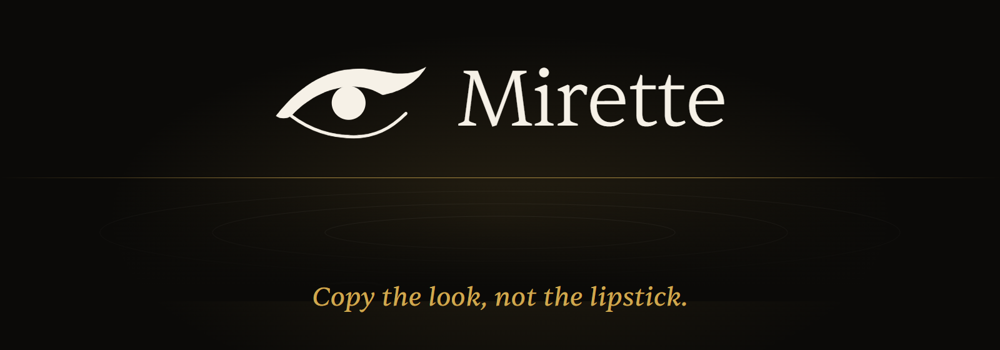
</p>

Mirette is a phone-first makeup website. It reads your face with the YouCam API, predicts how each shade will look on your skin, and rebuilds a creator's look from real products that work on you. A Neo4j graph connects face traits, product attributes, colours, sellers and looks, and a model learns from what shoppers do.

The name comes from the French *se mirer*, to see yourself in water, so every screen is a photograph above moving black water.

Built for the [YouCam API Skin AI & eCommerce VTO Hackathon](https://youcam-api-skin-ai-ecommerce.devpost.com/).

## Contents

- [The app](#the-app)
- [What it does](#what-it-does)
- [Architecture](#architecture)
- [The Neo4j product graph](#the-neo4j-product-graph)
- [YouCam API integration](#youcam-api-integration)
- [The recommendation engine](#the-recommendation-engine)
- [Look translation](#look-translation)
- [Learning from behaviour](#learning-from-behaviour)
- [Guided capture and on-device preview](#guided-capture-and-on-device-preview)
- [Catalog pipeline](#catalog-pipeline)
- [Security and privacy](#security-and-privacy)
- [Quality and CI](#quality-and-ci)
- [Results](#results)
- [Run it](#run-it)
- [Project layout](#project-layout)
- [Limits](#limits)

## The app

<table>
  <tr>
    <td width="25%">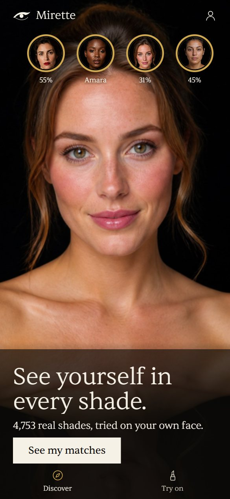</td>
    <td width="25%">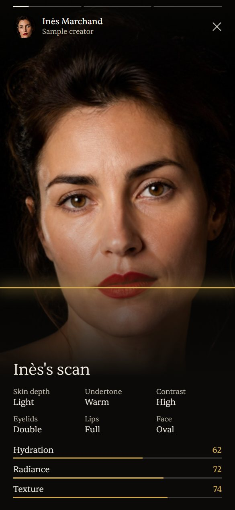</td>
    <td width="25%">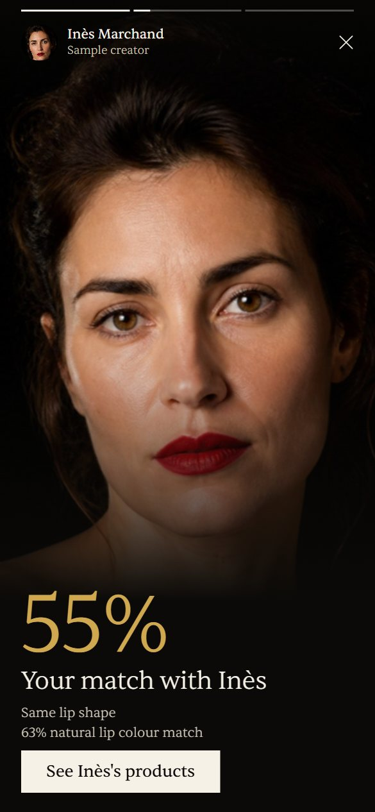</td>
    <td width="25%">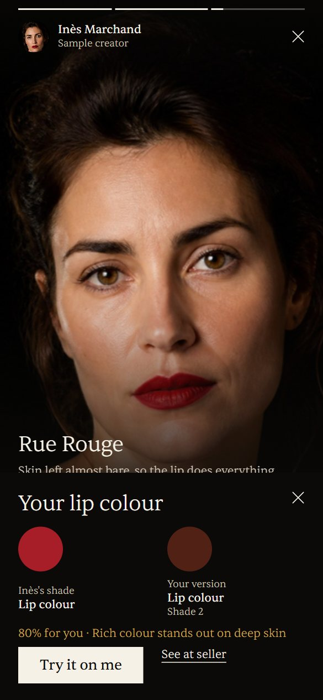</td>
  </tr>
  <tr>
    <td align="center">Discover and stories</td>
    <td align="center">A creator's scan</td>
    <td align="center">Your match</td>
    <td align="center">Your shade</td>
  </tr>
  <tr>
    <td width="25%">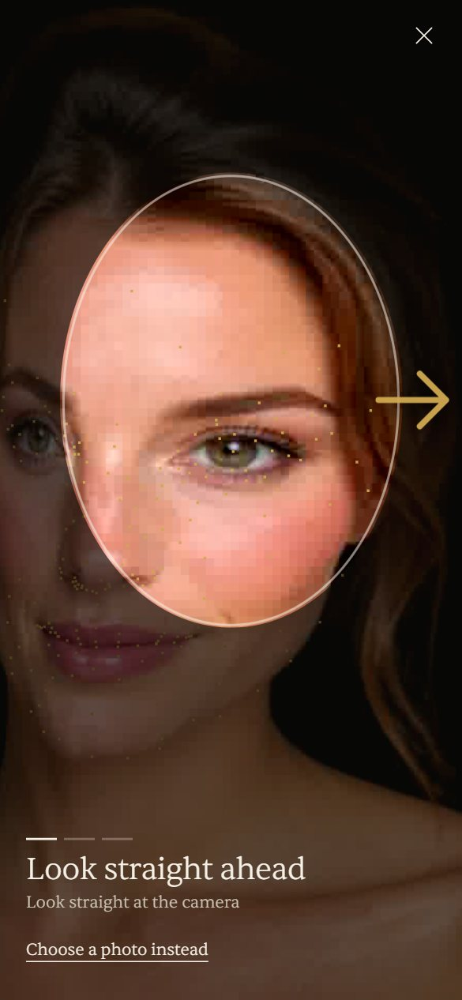</td>
    <td width="25%">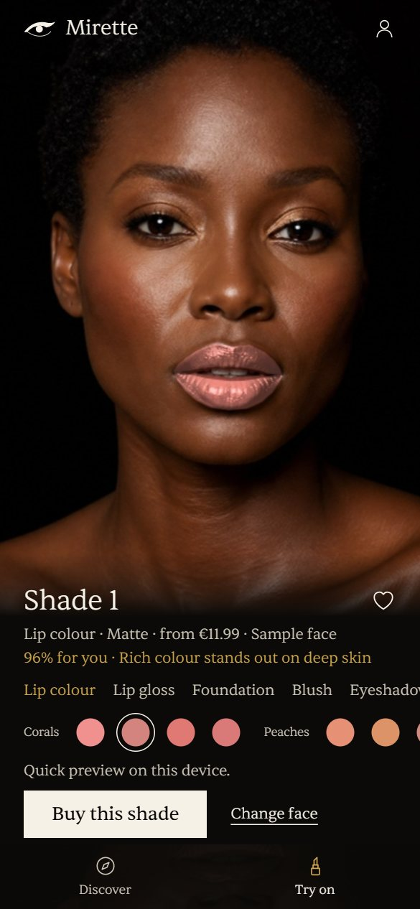</td>
    <td width="25%">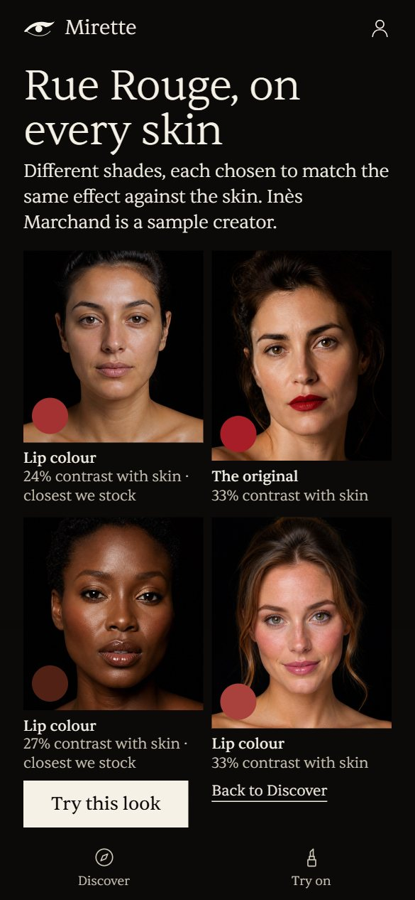</td>
    <td width="25%">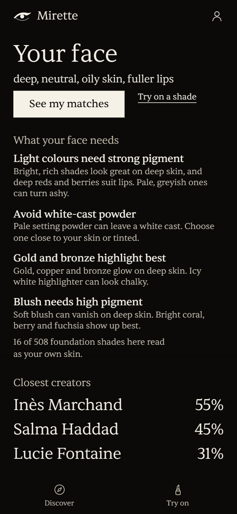</td>
  </tr>
  <tr>
    <td align="center">Guided selfie</td>
    <td align="center">Try on</td>
    <td align="center">Look translation</td>
    <td align="center">Your guide</td>
  </tr>
</table>

These screens come from the brand-free build. Every face is AI-made and labelled as a sample.

## What it does

| Feature | What the shopper gets |
|---|---|
| Guided selfie | Front, left and right photos taken automatically, with a live face mesh, a large arrow for each move, and coaching on pose and light |
| Face reading | Skin, lip, eye, brow and hair colours, skin condition and face shape, turned into a guide to what this face needs |
| Fit | A best shade, score and plain reason for every product |
| Try-on | Shades and whole looks on your own face: an instant preview, then the YouCam render |
| Look translation | A creator's look rebuilt from real shades for your skin |
| Creator stories | Story circles on Discover. Each opens a creator's scan and scores, your match with them and their products, and tapping a product gives your own shade |
| Shopping | Seller comparison, a near-identical colour for less, and a count of foundation shades that really reach your skin |

Mirette scores how a product fits a face. It never scores the face.

## Architecture

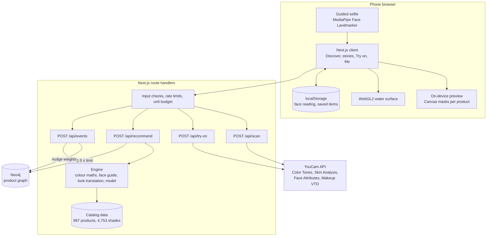

The stack is Next.js 16, React 19, TypeScript, Neo4j 5, MediaPipe Tasks Vision, raw WebGL2 and sharp.

Three decisions shape the system:

- **The face stays on the device.** The browser keeps the reading and sends it with each request, so the server stores no face.
- **Every external service can fail.** Neo4j has a built-in fallback, and try-on has an on-device preview. The app keeps working with no keys at all.
- **The same code serves real and simulated shoppers.** `lib/engine.ts` scores both, so the model trains on exactly what production runs.

### From selfie to recommendation

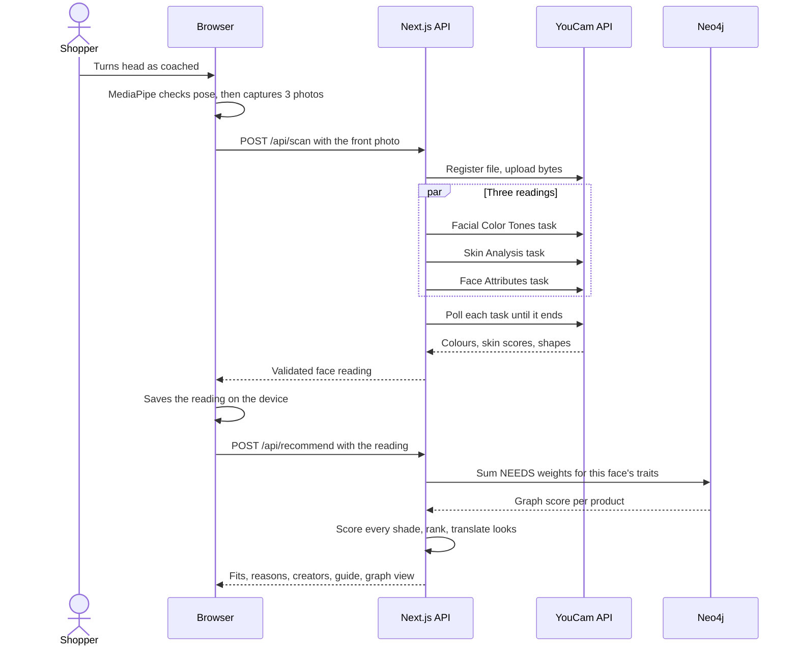

### Try-on

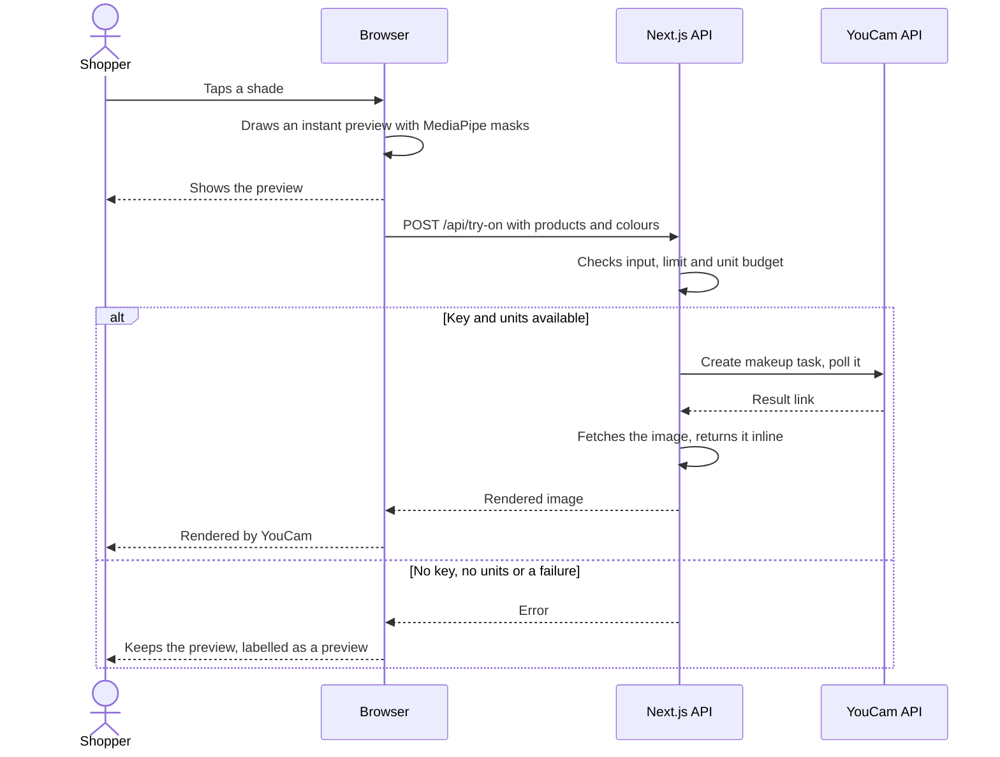

## The Neo4j product graph

Makeup advice is relational. A face trait needs an attribute, products carry attributes, and products connect to sellers, colours and looks. A graph stores those links directly, so a single traversal can answer a question that spans all of them.

### Schema

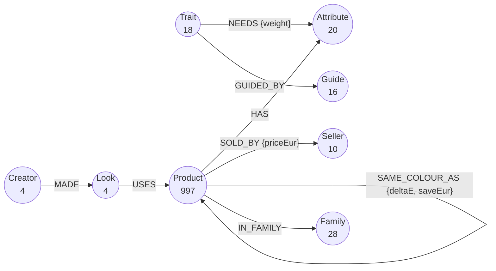

| Relationship | Count on a fresh load | Meaning |
|---|---:|---|
| `HAS` | 1,886 | A product has a finish, coverage, formula or claim |
| `SOLD_BY` | 1,018 | A seller offers the product at a price in euros |
| `SAME_COLOUR_AS` | 321 | A cheaper product is nearly the same colour |
| `IN_FAMILY` | 216 | A product belongs to a family such as "Matte reds" |
| `NEEDS` | 20 | A trait wants an attribute, with a learned weight |
| `GUIDED_BY` | 16 | A trait links to advice from the face guide |
| `USES` | 12 | A look uses a product |
| `MADE` | 4 | A sample creator made a look |

That is 1,098 nodes and 3,493 relationships. `NEEDS` grows as real actions connect new trait and attribute pairs.

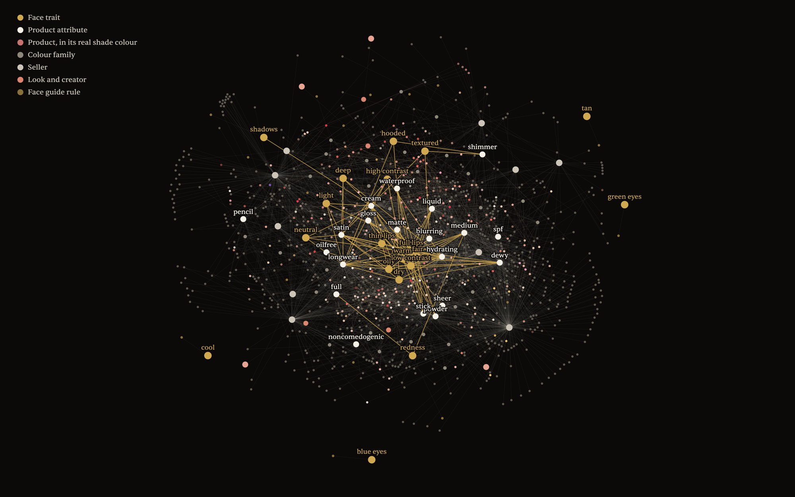

This is the real graph, read from the database. Each product dot is drawn in its own shade colour, gold lines are `NEEDS` links, and hubs are attributes, sellers and colour families.

The trait nodes hold categories such as `oily`, `hooded` and `depth:deep`. No shopper, face or photo enters the graph.

### Scoring every product with one traversal

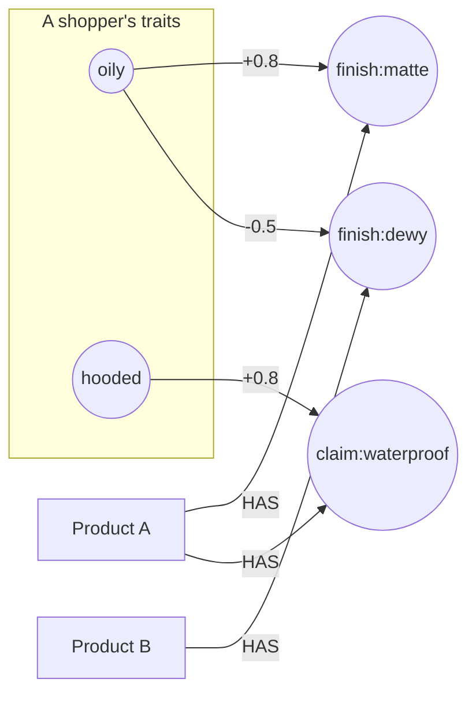

Product A collects +1.6 and rises. Product B collects -0.5 and falls.

```cypher
MATCH (t:Trait)-[n:NEEDS]->(:Attribute)<-[:HAS]-(p:Product)
WHERE t.name IN $traits
RETURN p.id AS id, sum(n.weight) AS weight
```

The result becomes one signal in the ranking model, where 0.5 means the graph has nothing to say:

```math
g = \mathrm{clip}\Big(0.5 + \frac{1}{2} \sum_{t \in T_u} \sum_{a \in A_i} w_{ta},\ 0,\ 1\Big)
```

For three traits, this query scores 742 products in a median of 37 ms on the local Docker instance.

### Queries the graph makes simple

Cheaper swaps for one product:

```cypher
MATCH (p:Product {id: $id})-[r:SAME_COLOUR_AS]->(swap:Product)
RETURN swap.title, r.deltaE, r.saveEur
ORDER BY r.deltaE, r.saveEur DESC
```

Products that suit a trait and also have a cheaper match, which crosses three kinds of relationship:

```cypher
MATCH (:Trait {name: 'oily'})-[n:NEEDS]->(:Attribute)<-[:HAS]-(p:Product)
      -[r:SAME_COLOUR_AS]->(swap:Product)
WHERE n.weight > 0
RETURN p.title, swap.title, r.saveEur
ORDER BY r.saveEur DESC
LIMIT 10
```

Average saving and colour gap by product type:

```cypher
MATCH (a:Product)-[r:SAME_COLOUR_AS]->()
RETURN a.type AS type, count(r) AS swaps,
       round(avg(r.deltaE), 2) AS meanDeltaE,
       round(avg(r.saveEur), 2) AS meanSaving
ORDER BY swaps DESC
```

Everything a look touches:

```cypher
MATCH path = (:Creator)-[:MADE]->(:Look {id: 'rue-rouge'})-[:USES]->(:Product)-[:SOLD_BY|IN_FAMILY]->()
RETURN path
```

### How the graph learns

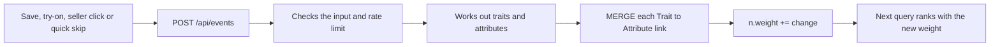

```cypher
UNWIND $traits AS trait
UNWIND $tags AS tag
MERGE (t:Trait {name: trait})
MERGE (a:Attribute {name: tag})
MERGE (t)-[n:NEEDS]->(a)
ON CREATE SET n.weight = 0
SET n.weight = n.weight + $change
```

A liked action raises a link and a quick skip lowers it. New pairs start at zero, so the graph can discover links the rules never listed.

### Reliable by design

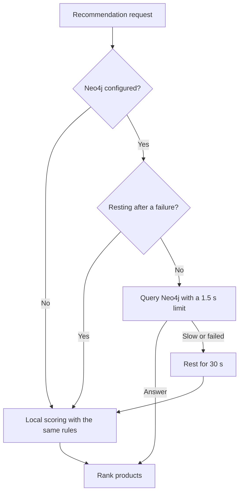

A shopper never waits on the database, and one outage doesn't slow every request. Local scoring matched Neo4j on all 518 products compared.

The loader in `scraper/load-graph.mts` is safe to run repeatedly:

- It creates 9 uniqueness constraints and an index on product type first, so each `MERGE` finds its node quickly.
- It writes products in batches of 200 with `UNWIND`.
- It removes stale products, sellers, looks, creators and families.
- It rebuilds derived links, but `ON CREATE` protects learned `NEEDS` weights.

Read queries use `routing: READ`, so they work with a clustered database as well as a single instance.

## YouCam API integration

The API key stays on the server, in `lib/youcam.ts`. Every task follows one path: register the file, upload the bytes, create a task, then poll until it ends.

| API | Task | Units | What Mirette uses |
|---|---|---:|---|
| Facial Color Tones | `skin-tone-analysis` | 20 | Skin, lip, eye, brow and hair colours, the input to all colour maths |
| Skin Analysis | `skin-analysis` | 14 | 11 concerns, including oiliness, moisture, texture, pores and redness |
| Face Attributes | `face-attr-analysis` | 20 | Eyelids, eye shape, lip shape, face shape and cheekbones |
| Makeup Virtual Try-On | `makeup-vto` | 1 | The render on the shopper's own face |

A full scan costs 54 units. `lib/units.ts` reserves units before each call and returns them after a failure, so requests arriving together can't overspend the budget.

## The recommendation engine

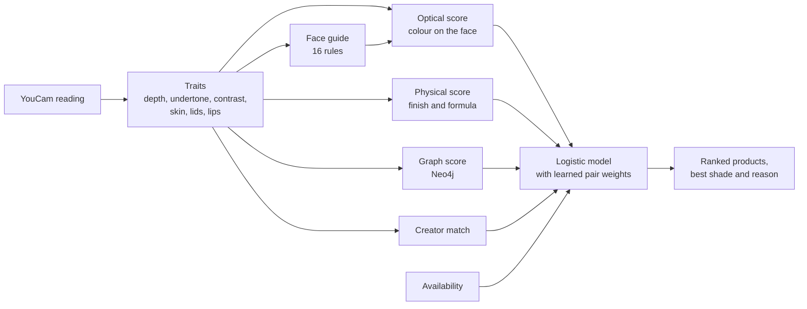

### Skin tone

All colour work happens in CIELAB. Depth uses the Individual Typology Angle rather than Fitzpatrick types:

```math
\mathrm{ITA} = \frac{180}{\pi}\,\mathrm{atan2}(L - 50,\ b)
```

### Colour on the face

Makeup sits as separate particles over partly exposed skin, not as a solid film. After Park et al. (2026), colour follows a smoothstep interpolation with a small lightness-dependent exponent. For base colour $B$, product colour $P$ and coverage $c$:

```math
\hat{c} = c^2(3 - 2c)
\qquad
\lambda = \max\big(-40,\ \min(40,\ L_P - L_B)\big)
\qquad
\omega = \hat{c}^{\ 1 - 0.006\lambda}
```

```math
F = B + \omega\,(P - B)
```

$B$ is the skin for face products and the natural lip for lip products. The constants are our estimates, and the use on lips and cheeks is our extension.

### Optical fit

Foundation combines the on-face gap and the direct gap to the skin:

```math
S_{\mathrm{base}} = 1 - \frac{0.7\,\Delta E_{00}(F, \mathrm{skin}) + 0.3\,\Delta E_{00}(P, \mathrm{skin})}{14}
```

Lips aim for a contrast set by the face, where $K$ is the lightness gap between skin and the darkest of hair and brow, and $H$ is undertone harmony:

```math
\tau = 14 + 0.42\,K
\qquad
\mathrm{fit} = 1 - \frac{\big|\ |L_F - L_{\mathrm{skin}}| - \tau\ \big|}{36}
\qquad
S_{\mathrm{lip}} = 0.62\,\mathrm{fit} + 0.38\,H
```

The 16 rules in `lib/guide.ts` then adjust the score and supply the reason. A pale, greyish shade on deep skin loses 0.24 with an ashiness warning, and a rich lip colour gains 0.18.

### Creator match

The score is per look, because a look only transfers if the traits that matter for it are shared:

```math
M = \sum_k \alpha_k\, s_k
```

A lip look weighs skin depth 0.30, lip shape 0.30, natural lip colour 0.25 and undertone 0.15. It compares traits and never identifies anyone.

## Look translation

We did not find this method in the literature. Pixel transfer copies a reference, and earlier recommenders pick a style. Mirette stores a look as its effect on the wearer, then searches real products for that effect on another face.

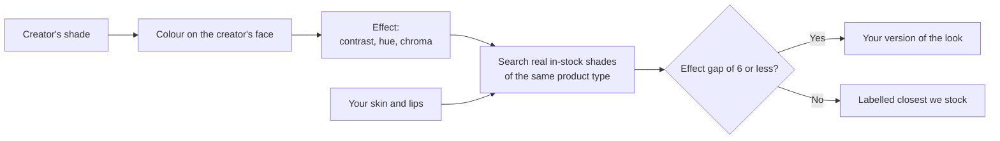

For skin $s$ and a shade with on-face colour $F$:

```math
E = \left( \frac{L_F - L_s}{L_F + L_s},\ h_F,\ C_F - C_s \right)
```

The first term adapts the facial contrast measure of Porcheron et al. (2017). The others are hue, and chroma relative to the skin. The gap between two effects, with hue wrapped the shorter way round, is:

```math
d = \sqrt{(100\,\Delta\kappa)^2 + (0.4\,\Delta h)^2 + (0.5\,\Delta\chi)^2}
```

The search then takes the closest real shade:

```math
p^{\ast} = \arg\min_{p \in S}\ d\big(E(\mathrm{creator}, p_0),\ E(\mathrm{shopper}, p)\big)
```

For the look Rue Rouge, contrast is 33% on the original face, 33% on one sample face, and 24% and 27% on two others. Those last two are labelled closest we stock, because the catalog has no true equivalent.

## Learning from behaviour

The ranker is a logistic model with a learned weight for each trait and attribute pair. It starts from hand-set weights, so the rules work before any data exists.

```math
\hat{p} = \sigma\Big(\mathbf{w}^\top \mathbf{x} + \sum_{t \in T_u} \sum_{a \in A_i} \theta_{ta}\Big)
```

Here $\mathbf{x}$ holds a bias, optical, physical, creator, graph and availability. Each event updates it online, with learning rate $\eta = 0.05$ and strength $\kappa$ of 1 for a seller click, 0.7 for a save, 0.6 for a try-on and 0.3 for a quick skip:

```math
\delta = \eta\,\kappa\,(y - \hat{p})
\qquad
\mathbf{w} \leftarrow \mathbf{w} + \delta\,\mathbf{x}
\qquad
\theta_{ta} \leftarrow \theta_{ta} + \frac{1.5\,\delta}{\sqrt{1 + n_{ta}/40}}
```

Exploration is Thompson-style. Noise on the logit shrinks as evidence grows, so new products still get shown:

```math
\tilde{p} = \sigma(\ell + \varepsilon\,s), \quad \varepsilon \sim \mathcal{N}(0, 1), \quad s = \frac{1.1}{\sqrt{1 + \bar{n}/15}}
```

The shipped weights in `data/model.json` come from simulated shoppers. Live updates stay in memory on each server instance, and Neo4j holds the durable `NEEDS` weights.

## Guided capture and on-device preview

The selfie guide reads face landmarks 9 times a second and estimates head turn:

```math
\mathrm{yaw} = \frac{x_{\mathrm{nose}} - \frac{1}{2}(x_{\mathrm{left}} + x_{\mathrm{right}})}{\left| x_{\mathrm{right}} - x_{\mathrm{left}} \right|}
```

MediaPipe's landmarks are drawn over the video as a gold mesh, so the tracking is visible. A large arrow shows the next move: turn, shift, come closer or step back. A photo is taken once the pose holds for 750 ms. The rules in `lib/capture.ts` are pure functions, so they have unit tests. Side photos stay on the device, where they flag uneven light when a reading differs from the front by more than a CIEDE2000 of 9.

The preview in `lib/preview.ts` builds a mask for each product from the landmarks and blends the shade in place, keeping the skin's own shading. It appears instantly and costs no units.

### Water surface

`lib/basin.ts` is a height field on the GPU with no 3D library, stored in `RGBA16F` ping-pong textures:

```math
v' = 0.991\,\big(v + 1.6(\bar{h} - h)\big)
\qquad
h' = 0.999\,(h + v')
```

Without WebGL2 the app shows plain images, and with reduced motion the water holds still.

## Catalog pipeline

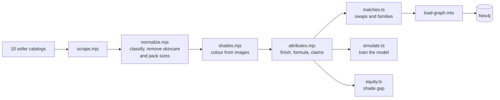

Each shade colour is the median of the coloured pixels in the central 60% of its image, filtered by plausible hue. If at least 60% of a product's shades fall within a Lab distance of 5, those colours came from the packaging and are dropped. That leaves 2,159 usable colours.

Cheaper matches need the same kind of product, another brand, a CIEDE2000 of 3 or less, a saving of at least €2, and finishes that don't clash. That gives 147 products with 321 matches and a median saving of €11.95.

## Security and privacy

- The YouCam key and Neo4j password stay on the server, in `.env.local`, which git ignores.
- Every route checks its input in `lib/validate.ts`, because a face from the browser is untrusted.
- Photos are limited to JPG or PNG under 10 MB.
- Routes that spend units, run the engine or write to the graph have per-visitor limits.
- The image route only accepts hosts found in the catalog, so it can't act as an open proxy.
- All Cypher uses parameters.
- Responses set `nosniff`, deny framing, limit the referrer, and allow the camera for this site only.
- The face reading stays in the shopper's browser, and **Delete my scan** clears it. The front photo goes to YouCam for analysis.

## Quality and CI

GitHub Actions runs two jobs on every push and pull request:

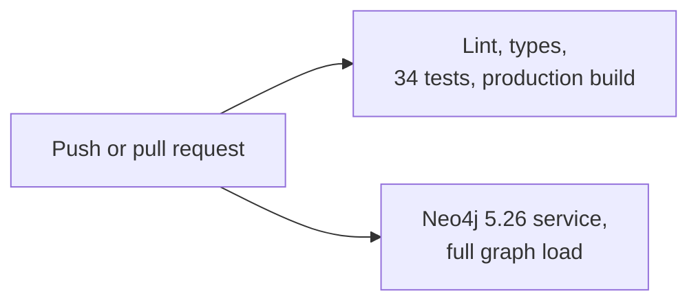

The tests cover colour maths, the coverage model, the face guide, look translation, the model, capture rules, input checks, rate limits and the unit budget.

```bash
npm run check
```

Live YouCam calls need a key, so CI doesn't cover them.

## Results

These results use simulated shoppers with hidden tastes, trained on 900 shoppers and 10,800 events, then tested on 200 unseen shoppers. They show that the engine can learn, not that its advice is right.

| Strategy | Average chance of liking a top-ten pick |
|---|---:|
| Random | 23.7% |
| Rules only | 38.5% |
| After learning | 48.2% |

| Skin depth (ITA) | Rules only | After learning |
|---|---:|---:|
| Fair | 40.1% | 50.2% |
| Light | 38.1% | 48.0% |
| Medium | 38.6% | 47.4% |
| Tan | 37.5% | 48.1% |
| Deep | 36.5% | 45.2% |

Learning lifted every group but didn't close the gap. Part of the cause is the catalog. This is the share of 832 foundation and concealer shades within a CIEDE2000 of 4 of each reference skin tone:

| Reference skin | Share of shades |
|---|---:|
| Very light | 1.2% |
| Light | 9.5% |
| Intermediate | 7.7% |
| Tan | 3.8% |
| Brown | 2.5% |
| Dark | 1.4% |

## Run it

You need Node 22. Docker is only needed for a local graph.

```bash
npm install
```

```bash
cp .env.example .env.local
```

```bash
npm run dev
```

Open http://localhost:3000. On **Try on**, choose **Use a sample face** to see the engine work with no keys.

### Add Neo4j

Set `NEO4J_PASSWORD` in `.env.local`, then start the database and load the graph:

```bash
docker compose --env-file .env.local up -d
```

```bash
npm run graph
```

Neo4j Browser is at http://localhost:7474. For Neo4j Aura, set `NEO4J_URI` to its `neo4j+s://` address and run `npm run graph` once.

### Environment

| Name | Purpose |
|---|---|
| `YOUCAM_API_KEY` | Live scans and try-on |
| `YOUCAM_UNIT_BUDGET` | Stops live use at this many units. Defaults to 400 |
| `NEO4J_URI`, `NEO4J_USERNAME`, `NEO4J_PASSWORD` | Connects the graph |
| `BRAND_FREE` | Set to `1` to show only the project's own images, with no brand or seller names |

### Commands

| Command | What it does |
|---|---|
| `npm run dev` | Starts the development server |
| `npm run build` | Builds for production |
| `npm run check` | Runs lint, types and tests |
| `npm run graph` | Loads the catalog into Neo4j |
| `npm run simulate` | Retrains the model on simulated shoppers |
| `npm run matches` | Finds cheaper colour matches and colour families |
| `npm run equity` | Measures the shade gap by skin tone |
| `npm run looks` | Makes brand-free photos with YouCam, at 1 unit each |

To rebuild the catalog, run `node scraper/scrape.mjs`, then `normalize.mjs`, `shades.mjs` and `attributes.mjs` from the same folder.

## Project layout

```text
app/                 Pages and API routes
  api/               scan, try-on, recommend, events
components/          Feed, creator stories, try-on, guided selfie, Me, water
lib/
  color.ts           CIELAB, CIEDE2000, ITA
  suit.ts            Optical and physical fit, coverage model
  guide.ts           The face guide
  translate.ts       Look translation
  learn.ts           Logistic model and exploration
  engine.ts          Scores one product for one face
  recommend.ts       What the app asks the engine
  graph.ts           Neo4j client and local fallback
  youcam.ts          YouCam client
  capture.ts         Guided selfie rules
  preview.ts         On-device preview and face reading
  basin.ts           WebGL2 water
  validate.ts        Input checks
  rate-limit.ts      Per-visitor limits
  units.ts           YouCam unit budget
scraper/             Catalog pipeline, simulation and graph loader
data/                Catalog, attributes, matches and trained model
docs/                Matching rules and research notes
```

Further reading: [how Mirette decides what suits a face](docs/MATCHING.md), [the research behind it](docs/RESEARCH.md) and [the design](DESIGN.md).

## Limits

- The YouCam client was tested against a local stub built from the public docs. It still needs a run against the live API.
- Shade colours are estimated from product images, not measured swatches.
- The coverage constants and face guide values are our estimates, and Park et al. measured foundation only.
- Look translation hasn't been tested on real people.
- Simulated shoppers show that the engine learns, not that its advice is right.
- The on-device preview isn't a YouCam result, and the app labels it.
- Rate limits and the unit budget live in memory, so each server instance counts alone.
- Sample creators and faces are AI-made and labelled.
- Skin scores are cosmetic guidance, not medical advice.

## License

[MIT](LICENSE)

<p align="center">
  
</p>
